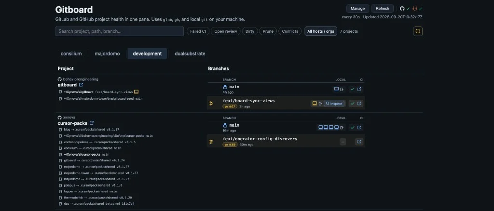

# Gitboard



Local code-change board for CI status, open PRs/MRs, failed-job triage, and local checkout / worktree state. Uses `gh`, `glab`, and `git` on your machine (not deployments or runtime ops).

Adapters support GitHub, GitLab, Azure DevOps, and Bitbucket. Manage Sources/Discover and interactive `gitboard sync` currently expose GitHub and GitLab only.

## Install (binary)

1. Install and log in to the forge CLIs:

```bash
brew install gh glab
glab auth login
gh auth login
```

2. Download the `gitboard` archive for your OS from the [latest release](https://github.com/behaviorengineering/gitboard/releases/latest), unpack it, and put `gitboard` on your `PATH`. (`go install github.com/behaviorengineering/gitboard/cmd/gitboard@vX.Y.Z` also works; `gitboard version` reports the module tag via BuildInfo.)

3. Run:

```bash
gitboard serve
```

The first run creates `~/.config/gitboard/config.yaml` if missing (never overwrites). Open [http://127.0.0.1:1325/](http://127.0.0.1:1325/), then use **Manage** (or `gitboard sync`) to add projects. Optional: edit the `llm` section for AI triage.

Each GitHub Release includes notes for what changed since the previous tag.

`process-compose` is only needed for the from-source `go tool task serve` TUI below.

## From source

```bash
brew install gh glab process-compose
glab auth login
gh auth login
git clone https://github.com/behaviorengineering/gitboard.git
cd gitboard
go tool task serve
```

Open [http://127.0.0.1:1325/](http://127.0.0.1:1325/). Stop with `go tool task serve-down`. `go tool task serve` and `gitboard serve` both create the config file if it is missing.

`go tool task serve` runs a **process-compose** TUI. The CLI `gitboard serve` still works for one-off runs without the TUI.

## Config

User config lives at `~/.config/gitboard/config.yaml` (or `$XDG_CONFIG_HOME/gitboard/config.yaml`).

Every command finds the config file in this order; the first match wins:

1. `--config <path>`
2. `GITBOARD_CONFIG` (legacy: `GITBOARD_PROJECTS`)
3. `$XDG_CONFIG_HOME/gitboard/config.yaml` (default `~/.config/gitboard/config.yaml`), if it exists
4. `./config.yaml` in the current directory (legacy: `./projects.yaml`), if it exists
5. otherwise the XDG path from step 3, which `init` and `serve` create

| Section | Purpose |
|---------|---------|
| `llm` | Optional AI triage (`base_url`, `model`, `api_key`) |
| `openinference` | Optional tracing and inference failure dumps |
| `ui` | Dashboard settings (see below) |
| `local` | Disk roots to scan for checkouts / worktrees (`roots`, `fetch_seconds`, `scan_seconds`) |
| `sync` | Discovery sources for GitHub, GitLab, Azure DevOps, and Bitbucket |
| `projects` | Curated tracked repos (written by `sync`; optional `local_path`) |
| `views` | Named board subsets of project ids (optional; omit for one default view over all projects) |

`ui` fields:

| Key | Purpose |
|-----|---------|
| `poll_seconds` | Browser auto-refresh interval (default 30; `0` disables) |
| `hide_branches` | Optional `path.Match` patterns; matching branch names are omitted from the Branches column only (prune / forge data unchanged). Empty or omitted shows all. |

```yaml
ui:
  poll_seconds: 30
  hide_branches:
    - majordomo-context/*
    - dependabot/*
```

Edit projects, views, roots, or `ui.hide_branches` while `serve` is running. The server reloads the config when the file changes; no restart required.

Board pulls are fast-forward only. After a pull, Gitboard runs `git submodule update --init --recursive` on the checked-out worktree.

LLM fields also accept env overrides: `GITBOARD_LLM_BASE_URL`, `GITBOARD_LLM_MODEL`, `GITBOARD_LLM_API_KEY`, `POLYPUS_BASE_URL`, `OPENAI_API_KEY`. Poll interval: `GITBOARD_POLL_SECONDS`. OpenInference: `GITBOARD_OPENINFERENCE_ENABLED`.

Tracing uses [olly](https://github.com/behaviorengineering/olly). `serve` and `sync` export spans over OTLP to the first endpoint set among `GITBOARD_OPENINFERENCE_ENDPOINT`, `POLYPUS_OTLP_ENDPOINT`, `openinference.endpoint`, `OTEL_EXPORTER_OTLP_TRACES_ENDPOINT` and `OTEL_EXPORTER_OTLP_ENDPOINT`. An `http://` or `https://` endpoint is sent OTLP over HTTP; a bare `host:port` uses gRPC unless `OTEL_EXPORTER_OTLP_PROTOCOL` says otherwise. With no endpoint, nothing is exported. `serve` writes a failure dump (`<trace id>.json` under `openinference.failure_dump.dir`, default `~/.config/gitboard/logs/inference-failures`) when an API request fails with a 5xx; `sync` writes none.

## Commands

| Command | Purpose |
|---------|---------|
| `gitboard init` / `go tool task init` | Create config if missing (never overwrite) |
| `gitboard sync` / `go tool task sync` | Discover repos and select tracked projects |
| `go tool task serve` | process-compose TUI on `:1325`; rebuilds/restarts when `.go` or static UI files change |
| `go tool task serve-down` | Stop this Gitboard process-compose project |
| `gitboard serve` | Direct dashboard (no process-compose) |
| `gitboard version` | Print the build version |

Sync helpers: `--add owner/repo --host github|gitlab|azuredevops|bitbucket`, `--remove id`, `--dry-run`, `--host github|gitlab|azuredevops|bitbucket`. Without a terminal, `sync` refuses the interactive path and names these flags. `sync --dry-run` writes nothing, not even a missing config file. Bare `gitboard` prints an operating guide (with the exit codes); `gitboard help` lists every command.

The dashboard API refuses requests a browser could send from another site: the `Host` header must name this server, and every write must be JSON with a same-site `Origin` (or none). `gitboard serve --allow-non-localhost` also prints a random token at startup; every write must send it in `X-Gitboard-Token` (the dashboard reads it from `/api/meta`).

`go tool task sync` uses an interactive TUI (Charm huh): arrow keys, space to toggle, `/` to filter, enter to confirm. Already-tracked repos start checked. The interactive prompt currently lists GitHub and GitLab sources.

## Local checkouts

Set `local.roots` to directories that contain clones (including nested submodules and linked worktrees). Gitboard matches `origin` remotes to tracked `host`/`path`.

Per-project override:

```yaml
projects:
  - id: gitboard
    label: gitboard
    host: github
    path: behaviorengineering/gitboard
    local_path: ~/Xynova/ai/gitboard
```

## Releases (for agents)

- Every releasable merge to `main` cuts a patch tag (`vX.Y.(Z+1)`) and publishes it with GoReleaser (`.github/workflows/auto-patch-release.yml`).
- No tag is cut when every commit since the last `v*` is `docs:`, `chore:` or `ci:`, when every changed path is agent harness (`.cursor/`, `.claude/`, `AGENTS.md`, `CLAUDE.md`, `lefthook.yml`, `scripts/git-hooks/`), or when the tip commit says `[skip release]`.
- Minor and major bumps are manual: run the **Auto patch release** workflow with the `bump` input.
- Pin a consumer to `vX.Y.Z` only after that workflow run is green, including its `verify` job.
- Merge the gitboard change first, then pin consumers to the post-merge `v*` tag (or the post-merge `main` SHA) in the same consumer PR as the related work. Never pin an open PR tip, and never open a pin-only follow-up PR.
- Before opening a consumer PR, check every pin: the `go.mod` require and any gitlink or skill link that points at this module.
